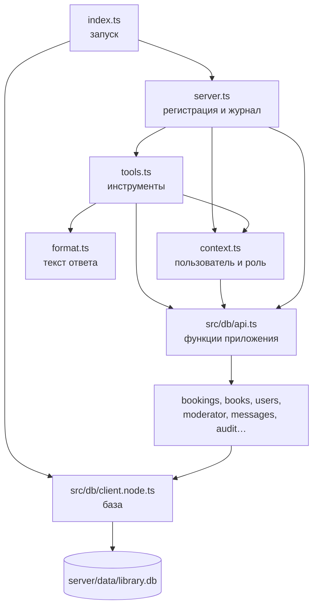

# MCP-сервер изнутри: разбор кода

Этот файл — для того, кто будет сдавать сервер и отвечать на вопросы по коду. Общая идея и словарь
есть в [MCP.md](MCP.md), здесь — что лежит в каком файле, что откуда подключается и зачем.
Номера строк указаны на момент написания; если код поменяется, ищите по названию функции.

---

## 1. Главная мысль в трёх предложениях

1. Claude Desktop запускает файл `mcp-server/dist/index.js` как обычную программу и переписывается
   с ним текстом через стандартный ввод и вывод (stdio).
2. Сервер объявляет список **инструментов**: название, описание, какие параметры нужны. Когда Claude
   вызывает инструмент, сервер проверяет права и вызывает **ту же функцию из `src/db`**, что и экран приложения.
3. Ответ — обычный текст на русском, теми же словами, что в приложении. Изменения записываются в журнал `mcp_audit`.

Своей логики библиотеки (лимиты, сроки, статусы броней) в сервере **нет** — она вся в `src/db`.
Сервер — это «переходник» между Claude и функциями приложения.

---

## 2. Карта файлов

```
mcp-server/
  package.json        зависимости и команды: build, test, inspect
  build.mjs           сборка всего сервера в один файл dist/index.js
  tsconfig.json       настройки TypeScript для проверки типов
  vitest.config.mts   настройки тестов
  src/
    index.ts          точка входа: запуск сервера (21 строка)
    server.ts         регистрирует инструменты, проверяет роль, пишет журнал (58 строк)
    context.ts        кто пользователь и какая у него роль (51 строка)
    tools.ts          все 20 инструментов (самый большой файл)
    format.ts         как превратить книгу или бронь в строчку текста
  test/
    tools.test.ts     51 автотест
  dist/index.js       результат сборки — его запускает Claude Desktop

src/db/               ОБЩИЙ код данных — им пользуются и приложение, и MCP-сервер
  api.ts              «оглавление»: собирает все функции данных в одно место
  client.node.ts      подключение к базе SQLite для Node (сервер)
  client.ts           то же для телефона (Expo) — сервер его НЕ использует
  password.node.ts    хэш пароля и код брони для Node
  messages.ts         тексты ошибок, общие для приложения и сервера
  audit.ts            запись в журнал mcp_audit
  schema.ts           таблицы базы (миграция 2 создаёт mcp_audit)
  bookings.ts, books.ts, users.ts, moderator.ts, catalogImport.ts, settings.ts — сами действия
```

Как файлы зависят друг от друга (стрелка — «импортирует»):



---

## 3. Запуск: от настроек Claude до первой строки кода

В `claude_desktop_config.json` записано:

```json
"campus-library": {
  "command": "C:\\Program Files\\nodejs\\node.exe",
  "args": ["C:\\...\\mcp-server\\dist\\index.js"],
  "env": { "LIBRARY_USER_EMAIL": "...", "LIBRARY_ROLE": "student", "LIBRARY_DB_PATH": "...\\library.db" }
}
```

То есть Claude Desktop при старте выполняет команду `node dist/index.js` и передаёт три
**переменные окружения** (`env`) — это как записка, приложенная к запуску программы. Код читает их через `process.env`.

### `src/index.ts` — точка входа

```ts
async function main(): Promise<void> {
  const ctx = contextFromEnv();          // 1. прочитать почту и роль из переменных окружения
  await getDb();                         // 2. открыть базу (создать и заполнить, если её нет)
  const server = createServer(ctx);      // 3. собрать сервер со всеми инструментами
  await server.connect(new StdioServerTransport()); // 4. начать слушать stdin/stdout
  console.error(`MCP-сервер библиотеки запущен...`);
}
```

[index.ts:10–16](../mcp-server/src/index.ts#L10)

- **`StdioServerTransport`** — готовый класс из официальной библиотеки MCP (`@modelcontextprotocol/sdk`).
  Он читает сообщения из стандартного ввода и пишет ответы в стандартный вывод. Сами сообщения — JSON.
- **Почему `console.error`, а не `console.log`.** Стандартный вывод (stdout) занят разговором с Claude.
  Если написать туда `console.log('привет')`, Claude получит «мусор» вместо JSON и связь сломается.
  Поэтому всё, что для человека, идёт в поток ошибок (stderr) — Claude Desktop складывает его в лог.
- Если что-то упало при запуске, срабатывает `main().catch(...)` → сообщение в stderr и выход с кодом 1
  ([index.ts:18–21](../mcp-server/src/index.ts#L18)). Claude Desktop покажет, что сервер не запустился.

---

## 4. Сборка: как TypeScript-код превращается в `dist/index.js`

Код написан на TypeScript (JavaScript с типами). Node умеет запускать только JavaScript,
поэтому перед запуском код **собирается**: `npm run build` → [build.mjs](../mcp-server/build.mjs).

```js
await build({
  entryPoints: ['src/index.ts'],     // откуда начать
  outfile: 'dist/index.js',          // куда положить результат
  bundle: true,                      // склеить все импортируемые файлы в один
  platform: 'node',
  alias: { '@': '../src' },          // «@/db/api» означает «../src/db/api»
  resolveExtensions: ['.node.ts', '.ts', '.js'],
  external: ['expo-*'],
});
```

Две важные хитрости:

1. **`alias '@'`.** В коде импорты пишутся как `import ... from '@/db/api'`. Символ `@` — это папка
   `src/` приложения. Благодаря этому сервер берёт **тот же самый файл**, что и приложение, а не копию.

2. **`resolveExtensions: ['.node.ts', ...]` — подмена файлов для компьютера.**
   Код данных писался для телефона: база через `expo-sqlite`, хэш пароля через `expo-crypto`.
   На компьютере этих модулей нет. Поэтому рядом лежат файлы-двойники:

   | Импорт в коде | На телефоне берётся | В сервере берётся |
   |---|---|---|
   | `./client` | `client.ts` (expo-sqlite) | `client.node.ts` (встроенный в Node `node:sqlite`) |
   | `./password` | `password.ts` (expo-crypto) | `password.node.ts` (встроенный `node:crypto`) |

   Сборщик, встретив `import { getDb } from './client'`, сначала ищет `client.node.ts` — и находит его.
   Остальные файлы (`bookings.ts`, `users.ts` …) одни и те же. Поэтому правила библиотеки не продублированы.

   То же самое настроено для проверки типов (`"moduleSuffixes": [".node", ""]` в
   [tsconfig.json](../mcp-server/tsconfig.json)) и для тестов (`extensions` в [vitest.config.mts](../mcp-server/vitest.config.mts)).

Результат — один файл примерно 1,5 МБ, внутри уже есть библиотека MCP и zod. Для запуска нужен только Node.

---

## 5. База данных на компьютере: `src/db/client.node.ts`

Функции из `src/db` вызывают базу так: `db.getAllAsync(sql, ...)`, `db.runAsync(sql, ...)`. Это
интерфейс `expo-sqlite`. В Node есть своя SQLite (`node:sqlite`, класс `DatabaseSync`), но с другими
названиями методов. Поэтому написан **адаптер** — класс `NodeDatabase`
([client.node.ts:25](../src/db/client.node.ts#L25)), который говорит «на языке expo-sqlite», а внутри вызывает `node:sqlite`:

```ts
async getAllAsync<T>(sql: string, ...params: unknown[]): Promise<T[]> {
  return this.db.prepare(sql).all(...flat(params)) as T[];
}
```

Функция `init()` ([client.node.ts:75](../src/db/client.node.ts#L75)) при первом обращении:

1. Берёт путь к файлу из `LIBRARY_DB_PATH` или по умолчанию `server/data/library.db`, создаёт папку.
2. Включает `journal_mode = WAL` и `busy_timeout = 5000`. Это нужно, потому что с одним файлом
   одновременно работают **два процесса** — MCP-сервер и общий сервер приложения. WAL позволяет
   читать во время записи, а `busy_timeout` — подождать до 5 секунд, если файл занят, вместо ошибки.
3. Прогоняет **миграции** из `schema.ts`: номер версии хранится в `PRAGMA user_version`, недостающие
   шаги выполняются по порядку. Миграция 2 создаёт таблицу `mcp_audit`.
4. Если пользователей нет — заполняет базу тестовыми данными (`seedDatabase` из `src/mocks/seed.ts`).

`getDb()` ([client.node.ts:99](../src/db/client.node.ts#L99)) открывает базу один раз и дальше
возвращает то же подключение.

`password.node.ts` — хэш пароля: SHA-256 от строки `соль + ':' + пароль`, тот же алгоритм, что на
телефоне. Поэтому пароль, заданный в приложении, подходит и на сервере.

---

## 6. `src/db/api.ts` — одна дверь ко всем функциям

```ts
export * from './bookings';
export * from './books';
export * from './users';
export * from './moderator';
export * from './messages';
export * from './audit';
...
```

[api.ts](../src/db/api.ts) просто собирает всё в одно место. MCP-сервер импортирует только отсюда:
`import { createBooking, getSettings, ... } from '@/db/api'`. Экраны приложения импортируют из
`@/db` (`index.ts`), который в свою очередь берёт всё из `api.ts`.

---

## 7. `src/context.ts` — кто пользователь

[context.ts](../mcp-server/src/context.ts)

```ts
export type Context = { email: string; role: UserRole | null };
```

**Контекст** — данные о том, от чьего имени работает сервер. Создаётся один раз при запуске.

| Функция | Строка | Что делает |
|---|---|---|
| `contextFromEnv()` | [14](../mcp-server/src/context.ts#L14) | Читает `LIBRARY_USER_EMAIL` и `LIBRARY_ROLE` из переменных окружения. Роль — только `student` или `moderator`, иначе `null`. |
| `currentUser(ctx)` | [20](../mcp-server/src/context.ts#L20) | Ищет пользователя в базе по почте (`getUserByEmail`). Нет почты или нет такого человека — понятная ошибка. |
| `effectiveRole(ctx, user)` | [34](../mcp-server/src/context.ts#L34) | Итоговая роль. Модератор — только если **в базе** он модератор **и** в настройках не написано `student`. |
| `requireRole(ctx, role)` | [39](../mcp-server/src/context.ts#L39) | Проверка перед инструментом. Роль не та — бросает ошибку «Это действие доступно только модератору…». |

```ts
export function effectiveRole(ctx: Context, user: User): UserRole {
  if (user.role === 'moderator' && ctx.role !== 'student') return 'moderator';
  return 'student';
}
```

Смысл: настройка `LIBRARY_ROLE` может **понизить** права (модератор работает как студент), но не
**повысить**. Студент, написавший себе `moderator`, всё равно останется студентом.

**`UserError`** ([context.ts:12](../mcp-server/src/context.ts#L12)) — свой тип ошибки:
`class UserError extends Error {}`. Он означает «это нормальный отказ, покажи текст человеку как есть».
Любая другая ошибка считается сбоем программы (см. раздел 8).

---

## 8. `src/server.ts` — сборка сервера

[server.ts](../mcp-server/src/server.ts) делает три вещи.

### 8.1 Создаёт сервер и регистрирует инструменты

```ts
export function createServer(ctx: Context): McpServer {
  const server = new McpServer(
    { name: 'campus-library', version: '1.0.0' },
    { instructions: SERVER_INSTRUCTIONS },
  );
  for (const tool of TOOLS) {
    server.registerTool(
      tool.name,
      { description: tool.description, inputSchema: tool.input, annotations: { readOnlyHint: !tool.mutating } },
      async (args) => { ... },     // что делать при вызове
    );
  }
  return server;
}
```

[server.ts:33–58](../mcp-server/src/server.ts#L33)

- **`McpServer`** — класс из официальной библиотеки. Он сам отвечает Claude на служебные вопросы
  «какие у тебя инструменты?» (`tools/list`) и передаёт вызовы (`tools/call`) в нашу функцию.
- **`instructions`** — общая подсказка для Claude: где брать номер книги и что опасные действия
  сначала вызываются без подтверждения. Claude Desktop показывает её модели при подключении.
- **`inputSchema: tool.input`** — схема параметров (zod, см. раздел 9). Библиотека сама превращает её
  в JSON Schema для Claude и **сама проверяет** пришедшие параметры. Если Claude прислал строку вместо
  числа, наша функция даже не вызовется — вернётся ошибка проверки.
- **`readOnlyHint`** — пометка для Claude: инструмент только читает данные.

### 8.2 `runTool` — проверка роли и перехват ошибок

```ts
async function runTool(tool, args, ctx) {
  try {
    const user = tool.role === 'any' ? null : await requireRole(ctx, tool.role);
    return { ok: true, text: await tool.run(args, ctx, user) };
  } catch (e) {
    if (e instanceof UserError) return { ok: false, text: e.message };
    console.error(`[${tool.name}]`, e);
    return { ok: false, text: 'Не удалось выполнить действие из-за внутренней ошибки. Попробуйте ещё раз.' };
  }
}
```

[server.ts:16–26](../mcp-server/src/server.ts#L16)

- Роль проверяется **здесь, один раз для всех** инструментов. Самим инструментам не нужно помнить об этом.
- `UserError` → человек видит понятный текст. Любая другая ошибка → подробности уходят в лог (stderr),
  а человеку — общая фраза, без технических деталей.

### 8.3 Журнал `mcp_audit` и ответ Claude

```ts
async (args) => {
  const res = await runTool(tool, args, ctx);
  if (tool.mutating) {
    await logAudit({ userEmail: ctx.email, tool: tool.name, params: auditParams(args), ok: res.ok, result: res.text });
  }
  return { content: [{ type: 'text', text: res.text }], isError: !res.ok };
}
```

[server.ts:46–54](../mcp-server/src/server.ts#L46)

- Журнал пишется только для изменяющих инструментов (`mutating: true`), причём **всегда** — и при
  успехе, и при отказе, и при предпросмотре без подтверждения.
- `auditParams` ([server.ts:28](../mcp-server/src/server.ts#L28)) заменяет пароль на `***`, чтобы он не
  попал в журнал при регистрации.
- `logAudit` живёт в [src/db/audit.ts](../src/db/audit.ts#L15) — это обычный `INSERT INTO mcp_audit (...)`.
- Ответ Claude — формат MCP: список кусочков `content` (у нас один текстовый) и флаг `isError`.

---

## 9. `src/tools.ts` — инструменты

### 9.1 Как описан один инструмент

```ts
export type ToolDef<S extends z.ZodRawShape> = {
  name: string;          // имя, которое видит Claude: 'create_booking'
  description: string;   // описание на русском с примером фразы
  role: ToolRole;        // 'any' | 'student' | 'moderator'
  mutating: boolean;     // меняет данные? → писать в журнал
  input: S;              // схема параметров (zod)
  run: (args, ctx, user) => Promise<string>;  // что сделать; возвращает текст ответа
};
```

[tools.ts:63–73](../mcp-server/src/tools.ts#L63)

Функция-обёртка `tool({...})` ([tools.ts:79](../mcp-server/src/tools.ts#L79)) нужна для удобства
TypeScript: внутри `run` типы параметров выводятся из схемы автоматически (`args.book_id` — число),
а в общем списке `TOOLS` все инструменты хранятся одного вида.

### 9.2 Схемы параметров (zod)

**zod** — библиотека, которая описывает, какими должны быть данные, и проверяет их. Пример — номер книги:

```ts
const bookId = z
  .number({ error: 'Номер книги — целое число из search_books, например 3.' })
  .int('Номер книги — целое число из search_books, например 3.')
  .positive('Номер книги — целое число из search_books, например 3.')
  .describe('Номер книги в каталоге (поле id из search_books). Пример: 3');
```

[tools.ts:94–98](../mcp-server/src/tools.ts#L94)

- `.number()`, `.int()`, `.positive()` — правила: число, целое, больше нуля. В скобках — текст ошибки по-русски.
- `.describe(...)` — подсказка для Claude, она попадает в описание параметра. Везде есть «Пример: …».

Общие схемы вынесены наверх и переиспользуются: `confirm` (подтверждение, [86](../mcp-server/src/tools.ts#L86)),
`bookId` ([94](../mcp-server/src/tools.ts#L94)), `code` — код брони ([100](../mcp-server/src/tools.ts#L100)).

### 9.3 Разбор инструмента целиком: `create_booking`

```ts
const createBookingTool = tool({
  name: 'create_booking',
  description: 'Забронировать книгу — кнопка «Забронировать» в карточке книги. ...',
  role: 'student',                     // только студент; проверит server.ts
  mutating: true,                      // попадёт в журнал
  input: { book_id: bookId },          // один параметр — номер книги
  run: async ({ book_id }, _ctx, user) => {
    const book = await bookOrFail(book_id);              // 1. есть ли такая книга
    const res = await createBooking(user!.id, book_id);  // 2. ТА ЖЕ функция, что у кнопки в приложении
    const settings = await getSettings();
    if (!res.ok) throw new UserError(createBookingErrorText(res.error, settings)); // 3. отказ — текст из messages.ts
    const b = await getBooking(res.bookingId);           // 4. прочитать созданную бронь
    return `Бронь оформлена: «${book.title}». Книга ждёт вас до ${...}.\n... Код брони: ${b?.code}`;
  },
});
```

[tools.ts:319–341](../mcp-server/src/tools.ts#L319)

- `createBooking` из [src/db/bookings.ts](../src/db/bookings.ts) — та же функция, которую вызывает
  экран [app/book/[id].tsx](../app/book/[id].tsx). Внутри неё транзакция и все правила:
  лимит броней, есть ли книга на полке, нет ли её уже у читателя.
- Она возвращает `{ ok: false, error: 'limit' }`, а `createBookingErrorText` из
  [messages.ts](../src/db/messages.ts) превращает код ошибки в текст «У вас уже 3 активные брони…» —
  тот же текст, что в плашке приложения.
- `user!` — восклицательный знак говорит TypeScript «здесь точно не пусто»: для `role: 'student'`
  пользователь уже найден в `runTool`.

### 9.4 Подтверждение опасных действий: `cancel_booking`

```ts
run: async (args, ctx, user) => {
  const b = await bookingByCode(args.code, user!, ctx);           // найти бронь (только свою)
  if (b.status !== 'reserved') throw statusRefusal(b, 'отменить'); // выданную отменить нельзя
  if (!args.confirm) return `Отменить бронь на «${b.book.title}»? Книга сразу станет доступна другим.\n${CONFIRM_HINT}`;
  await cancelBooking(b.id, user!.id);                             // только теперь меняем базу
  return `Бронь ${b.code} на «${b.book.title}» отменена. Книга снова доступна другим.`;
},
```

[tools.ts:352–358](../mcp-server/src/tools.ts#L352)

Схема одна для всех опасных инструментов: **сначала все проверки, потом `if (!args.confirm) return …`,
и только после этого изменение**. Без `confirm: true` функция возвращает описание и выходит раньше,
чем дойдёт до `cancelBooking`. Текст вопроса взят из диалога приложения. `CONFIRM_HINT`
([format.ts:37](../mcp-server/src/format.ts#L37)) добавляет: «Ничего не изменено. Чтобы выполнить,
вызовите инструмент ещё раз с confirm: true.»

Так устроены `cancel_booking`, `return_book`, `issue_book`, `update_book`, `remove_book`, `mark_missing`, `import_books`.

### 9.5 Помощники внутри tools.ts

| Функция | Строка | Зачем |
|---|---|---|
| `bookOrFail(id)` | [108](../mcp-server/src/tools.ts#L108) | Книга по номеру или ошибка «Книга не найдена…» |
| `bookingByCode(code, user, ctx)` | [115](../mcp-server/src/tools.ts#L115) | Бронь по коду. Студенту чужая бронь «не найдена» — так он не видит чужие данные. |
| `statusRefusal(b, action)` | [127](../mcp-server/src/tools.ts#L127) | Текст «Бронь … нельзя отменить: сейчас она в статусе …» |
| `parseDate(value)` | [132](../mcp-server/src/tools.ts#L132) | Дата `2026-10-28` → время в миллисекундах |
| `duplicateWarning(isbn)` | [472](../mcp-server/src/tools.ts#L472) | Предупреждение о книге с таким же ISBN, как в форме |

### 9.6 Все инструменты и функции, которые они вызывают

| Инструмент | Роль | Меняет данные | Вызывает из `src/db` | Как в приложении |
|---|---|---|---|---|
| `search_books` | все | нет | `searchBooks`, `similarBooks` | строка поиска |
| `get_book` | все | нет | `getBookCard`, `bookStateNotice` | карточка книги |
| `list_my_bookings` | студент | нет | `getMyBookings` | вкладка «Брони» |
| `get_booking_by_code` | все | нет | `getBookingByCode` | экран брони |
| `list_journal` | модератор | нет | `getJournal` | журнал |
| `list_reconciliation` | модератор | нет | `getReconciliation` | список «Сверка» |
| `register` | все | да | `registerUser` | «Регистрация» |
| `create_booking` | студент | да | `createBooking` | «Забронировать» |
| `cancel_booking` ⚠ | студент | да | `cancelBooking` | «Отменить бронь» |
| `join_queue` | студент | да | `joinQueue` | «Встать в очередь» |
| `leave_queue` | студент | да | `leaveQueue` | «Выйти из очереди» |
| `return_book` ⚠ | студент | да | `markReturned` | «Я вернул книгу» |
| `update_profile` | все | да | `updateProfile` | «Редактировать профиль» |
| `add_book` | модератор | да | `addBook`, `findBookByIsbn` | «Новая книга» |
| `update_book` ⚠ | модератор | да | `updateBook` | «Правка книги» |
| `remove_book` ⚠ | модератор | да | `getActiveUsage`, `removeBook` | «Убрать из каталога» |
| `issue_book` ⚠ | модератор | да | `lookupForIssue`, `issueBookings`, `issueWithoutBooking` | «Выдача» |
| `check_return` | модератор | да | `closeOnShelf` | «На полке — закрыть» |
| `mark_missing` ⚠ | модератор | да | `markMissing` | «Нет на полке» |
| `import_books` ⚠ | модератор | да | `checkImportRows`, `commitImport` | «Импорт из таблицы» |

⚠ — нужен `confirm: true`. Порядок в списке `TOOLS` — [tools.ts:723](../mcp-server/src/tools.ts#L723).

---

## 10. `src/format.ts` — ответ текстом

[format.ts](../mcp-server/src/format.ts) — маленькие функции, которые делают из объекта строку:

- `bookLine(book)` → `• [id 3] «Грокаем алгоритмы» — А. Бхаргава, 2022… В наличии (на полке 3 из 4).`
  Номер `id` нужен, чтобы Claude мог следующим шагом вызвать `create_booking`.
- `bookingLine(booking)` → `• Код 7KQ4MX — «…»: Забронирована, ждёт до 16 октября, 20:00.`
  Подписи статусов берутся из `JOURNAL_STATUS` приложения ([src/lib/bookingStatus.ts](../src/lib/bookingStatus.ts)),
  даты — функциями `dayMonth`, `dayMonthTime` из [src/lib/format.ts](../src/lib/format.ts).
- `journalLine(booking)` — то же плюс имя читателя (для модератора).

---

## 11. Путь одного вызова по коду

Анна пишет: «Отмени бронь 7KQ4MX». Что происходит:

| # | Где | Что |
|---|---|---|
| 1 | Claude Desktop | Выбирает инструмент `cancel_booking`, отправляет в stdin сервера JSON: `{"method":"tools/call","params":{"name":"cancel_booking","arguments":{"code":"7KQ4MX"}}}` |
| 2 | `StdioServerTransport` (библиотека) | Читает строку, разбирает JSON, передаёт в `McpServer` |
| 3 | `McpServer` (библиотека) | Находит инструмент по имени, проверяет `arguments` схемой zod. `code` — непустая строка, всё в порядке |
| 4 | [server.ts:46](../mcp-server/src/server.ts#L46) | Вызывается наша функция → `runTool` |
| 5 | [server.ts:18](../mcp-server/src/server.ts#L18) | `requireRole(ctx, 'student')` → `currentUser` находит Анну по почте из env, роль студент — ок |
| 6 | [tools.ts:352](../mcp-server/src/tools.ts#L352) | `run`: `bookingByCode` → `getBookingByCode('7KQ4MX')` из `src/db/bookings.ts` → SQL к базе |
| 7 | [tools.ts:354](../mcp-server/src/tools.ts#L354) | Статус `reserved` — отменять можно |
| 8 | [tools.ts:355](../mcp-server/src/tools.ts#L355) | `confirm` нет → возвращается вопрос «Отменить бронь…? Ничего не изменено…». База не тронута |
| 9 | [server.ts:49](../mcp-server/src/server.ts#L49) | Инструмент изменяющий → `logAudit` пишет строку в `mcp_audit` (ok = 1, результат — текст вопроса) |
| 10 | [server.ts:53](../mcp-server/src/server.ts#L53) | Ответ `{content:[{type:'text', text:'Отменить бронь…'}], isError:false}` уходит в stdout |
| 11 | Claude Desktop | Показывает Анне вопрос. Анна: «да» |
| 12 | Снова шаги 1–7 | Теперь `arguments: {"code":"7KQ4MX","confirm":true}` |
| 13 | [tools.ts:356](../mcp-server/src/tools.ts#L356) | `cancelBooking(b.id, user.id)` из `src/db/bookings.ts` — `UPDATE bookings SET status='cancelled'…` в транзакции |
| 14 | Журнал и ответ | Ещё одна запись в `mcp_audit`, Claude получает «Бронь 7KQ4MX … отменена» |

---

## 12. Тесты: `test/tools.test.ts`

Запуск: `cd mcp-server`, затем `npm test`. Ожидаемо: `Tests 51 passed`.

Как устроено:

- **Отдельная база.** Перед всеми тестами путь к базе направляется во временную папку
  (`process.env.LIBRARY_DB_PATH = ...`), а перед каждым тестом `resetDatabase()` удаляет файл —
  он создаётся заново из тестовых данных. Настоящая база не трогается.
- **Настоящий MCP, но без процессов.** Функция `connect(email, role)` создаёт сервер через тот же
  `createServer`, а вместо stdin/stdout использует `InMemoryTransport` — «трубу в памяти» между
  сервером и тестовым клиентом `Client`. Так проверяется весь путь: схема → роль → инструмент → журнал.
- **Для каждого инструмента** — успешный вызов и ошибки: нет прав, лимит броней, неверные данные,
  вызов без `confirm` (и проверка, что в базе ничего не поменялось).
- Отдельно проверяется: у каждого инструмента и параметра есть описание с «Пример»; пароль не попадает
  в журнал; чтение в журнал не пишется; `LIBRARY_ROLE=moderator` не даёт прав студенту.

Пример теста:

```ts
it('без confirm ничего не меняет', async () => {
  const r = await student('cancel_booking', { code: '7KQ4MX' });
  expect(r.ok).toBe(true);
  expect(r.text).toContain('Ничего не изменено');
  expect((await getBookingByCode('7KQ4MX'))?.status).toBe('reserved');   // бронь осталась
});
```

---

## 13. Что показать преподавателю

1. **Сервер подключён.** Claude Desktop → чат → меню инструментов → `campus-library`, 20 инструментов.
2. **Тесты.** `cd mcp-server` → `npm test` → 51 зелёный тест.
3. **Inspector.** `npm run inspect` → Connect → Tools → List Tools: видно описания и схемы. Вызвать
   `search_books` с «грокаем».
4. **Код** в таком порядке: `index.ts` (запуск) → `server.ts` (регистрация, роль, журнал) →
   `context.ts` (пользователь) → `tools.ts` — `create_booking` и `cancel_booking` → `src/db/bookings.ts`
   (функция `createBooking`, которую вызывают и приложение, и сервер).
5. **Журнал.** Таблица `mcp_audit` в `server/data/library.db` — записи после демонстрации.

## 14. Вопросы по коду и короткие ответы

**Где сервер узнаёт пользователя?** `contextFromEnv` в `context.ts` читает `LIBRARY_USER_EMAIL`,
`currentUser` ищет его в базе через `getUserByEmail`.

**Где проверяются права?** Один раз для всех — в `runTool` (`server.ts`), через `requireRole` из `context.ts`.
У каждого инструмента в поле `role` записано, кому он доступен.

**Где проверяются параметры?** Дважды. Сначала схема zod в `input` инструмента (тип, обязательность) —
это делает библиотека MCP до вызова. Потом правила библиотеки внутри функций `src/db` (например,
`validateBook`, `validateRegistration`, лимит в `createBooking`).

**Почему логика не продублирована?** Сервер импортирует функции из `src/db` через `@/db/api`.
Сборщик подменяет только два файла (`client` и `password`) на версии для Node — остальное общее.

**Что будет, если внутри функции случится сбой?** `runTool` поймает исключение: подробности — в stderr
(лог Claude Desktop), человеку — «Не удалось выполнить действие из-за внутренней ошибки».

**Почему нельзя `console.log`?** stdout — канал протокола MCP. Посторонний текст сломает обмен JSON.

**Как устроено подтверждение?** В `run` опасного инструмента: проверки → `if (!args.confirm) return описание`
→ изменение. Без `confirm: true` выполнение не доходит до функции, меняющей базу.

**Где журнал?** `logAudit` в `src/db/audit.ts`, вызывается в `server.ts` для всех `mutating: true`.
Таблица создаётся миграцией 2 в `src/db/schema.ts`.

**Что такое `async`/`await`?** Работа с базой занимает время. `async`-функция возвращает «обещание»
(`Promise`) результата, а `await` ждёт его, не блокируя программу.

**Что такое `throw` и `catch`?** `throw new UserError('текст')` прерывает выполнение инструмента
и «бросает» ошибку наверх. `catch` в `runTool` её ловит и превращает в ответ `isError: true`.

**Почему один файл `dist/index.js`?** Так проще подключать: Claude Desktop нужен только Node и путь
к одному файлу, без установки зависимостей на месте.

**Как добавить новый инструмент?** Написать в `tools.ts` ещё один `tool({ name, description, role,
mutating, input, run })`, добавить его в массив `TOOLS`, написать тесты. Регистрация, проверка роли и
журнал заработают сами — они общие в `server.ts`.
