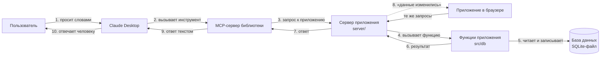

# Библиотека кампуса и Claude: как работает MCP-сервер

Документ для тех, кто не программирует. Термины объяснены в словаре в конце.

## 1. О проекте

«Библиотека кампуса» — мобильное приложение для студентов и библиотекарей. Студент находит книгу,
бронирует её, приходит на абонемент и показывает код из приложения. Если книги нет на полке, он встаёт
в очередь. Вернув книгу, он отмечает это в приложении. Библиотекарь (в приложении — «модератор») выдаёт
книги по коду, ведёт журнал выдач, сверяет возвраты на полках и пополняет каталог.

Вторая часть проекта — MCP-сервер. С ним всё то же самое можно сделать, просто попросив нейросеть
Claude в программе Claude Desktop: «Забронируй мне „Компьютерные сети“» или «Покажи просроченные выдачи».
Claude не обходит приложение стороной: он нажимает те же «кнопки», что и человек в приложении, и
получает в ответ те же самые сообщения.

## 2. Что такое MCP

**MCP (Model Context Protocol)** — общий для разных нейросетей способ подключать к ним программы.

Аналогия — **розетка и вилка**. Нейросеть умеет только разговаривать. Чтобы она что-то сделала в
реальной программе, к программе нужна «розетка» — MCP-сервер. Сервер говорит нейросети: «Вот что
я умею: искать книги, бронировать, отменять бронь. Вот что мне нужно для каждого действия». Нейросеть
выбирает подходящее действие и передаёт нужные данные. Розетка стандартная, поэтому одну и ту же
программу можно подключить к Claude Desktop, к другим программам с поддержкой MCP и к инструментам
для проверки.

**Чем это отличается от «нейросеть сама ходит по сайту».** Можно было бы научить нейросеть открывать
приложение, искать на экране кнопки и нажимать их, как это делает человек. Это медленно и ненадёжно:
поменяли дизайн — и нейросеть «промахивается». Через MCP нейросеть экран вообще не видит. Она получает
список действий с точным описанием, вызывает их напрямую и получает короткий понятный ответ. Что можно,
а что нельзя, решает наш сервер, а не нейросеть.

## 3. Как всё связано



1. **Пользователь → Claude Desktop.** Человек пишет обычную фразу в чат.
2. **Claude Desktop → MCP-сервер.** Claude понимает, какое действие нужно, и вызывает инструмент
   сервера, например `create_booking` с номером книги. Сервер работает на том же компьютере.
3. **MCP-сервер → сервер приложения.** MCP-сервер проверяет, кто пользователь и можно ли ему это действие,
   и отправляет запрос **серверу приложения** — тому же, к которому обращается приложение, открытое в
   браузере. В базу напрямую MCP-сервер не ходит: он работает с приложением, как ещё один его клиент.
4. **Сервер приложения → функции.** Сервер приложения вызывает ту же функцию, что и кнопка на экране.
   Своей «отдельной логики» ни у MCP-сервера, ни у сервера приложения нет — она вся в `src/db`.
5. **Функции → база данных.** Функция читает и записывает данные: книги, брони, очереди.
6–7. **Обратно.** Результат («бронь создана, код такой-то» или «лимит броней») возвращается MCP-серверу.
8. **Сервер приложения → браузер.** Если данные изменились, сервер сразу сообщает об этом открытому
   приложению, и экран обновляется сам, без перезагрузки страницы.
9. **MCP-сервер → Claude.** MCP-сервер превращает результат в понятный текст — теми же словами, что
   на экране приложения.
10. **Claude → пользователь.** Claude пересказывает ответ человеку.

Получается, что приложение в браузере и Claude — два способа работать с одним и тем же приложением.
Бронь, сделанная через Claude, тут же появляется во вкладке, а бронь, отменённая во вкладке, тут же
видна Claude.

## 4. Путь одного запроса: «Забронируй мне „Грокаем алгоритмы“»

1. Студентка Анна пишет в Claude Desktop: «Забронируй мне „Грокаем алгоритмы“».
2. Claude видит, что для брони нужен номер книги, и сначала вызывает поиск:
   `search_books`, запрос «Грокаем алгоритмы».
3. Сервер вызывает ту же функцию поиска, что и строка поиска в приложении, и отвечает:
   «[id 3] «Грокаем алгоритмы» — А. Бхаргава, 2022… В наличии (на полке 3 из 4).»
4. Claude вызывает `create_booking` с номером книги 3.
5. Сервер узнаёт пользователя по почте из настроек, проверяет, что это студент, и вызывает ту же
   функцию брони, что и кнопка «Забронировать».
6. Функция проверяет правила библиотеки: не больше трёх броней, книга есть на полке, у читателя её ещё нет.
   В тестовых данных эта книга уже выдана Анне и просрочена, поэтому ответ:
   «Эта книга уже забронирована или выдана вам.» — дословно как в приложении.
   С другой книгой ответ был бы: «Бронь оформлена… Книга ждёт вас до 16 октября, 20:00. Код брони: …».
7. Сервер записывает действие в журнал `mcp_audit`: кто, когда, что вызвал и чем закончилось.
8. Claude отвечает Анне человеческим языком и может предложить следующее: например, отметить возврат.

## 5. Инструменты

«Инструмент» — одно действие, которое сервер предлагает нейросети. Каждый повторяет форму или кнопку приложения.

| Инструмент | Какую форму заменяет | Что делает | Кто может вызвать | Пример фразы |
|---|---|---|---|---|
| `search_books` | Строка поиска | Ищет книги по названию, автору, ISBN | Все | «Есть ли книги Кормена?» |
| `get_book` | Карточка книги | Наличие, полка, что можно сделать | Все | «Расскажи про книгу 3» |
| `list_my_bookings` | Вкладка «Брони» | Мои брони, коды, сроки, очереди | Студент | «Какие книги у меня сейчас?» |
| `get_booking_by_code` | Экран брони | Бронь по коду из QR | Студент — свои, модератор — все | «Что с бронью 7KQ4MX?» |
| `register` | Вкладка «Регистрация» | Создаёт аккаунт читателя | Все | «Зарегистрируй Петра Иванова, petr@mail.ru» |
| `create_booking` | Кнопка «Забронировать» | Бронирует книгу | Студент | «Забронируй мне „Компьютерные сети“» |
| `cancel_booking` ⚠ | Кнопка «Отменить бронь» | Отменяет бронь | Студент | «Отмени бронь 7KQ4MX» |
| `join_queue` | Кнопка «Встать в очередь» | Ставит в очередь за занятой книгой | Студент | «Поставь меня в очередь за книгой 2» |
| `leave_queue` | Кнопка «Выйти из очереди» | Убирает из очереди | Студент | «Убери меня из очереди за книгой 2» |
| `return_book` ⚠ | Кнопка «Я вернул книгу» | Отмечает, что книга на полке | Студент | «Я вернул книгу по брони 9RT2WE» |
| `update_profile` | «Редактировать профиль» | Меняет имя, группу, почту, Telegram | Все | «Поменяй мою группу на ИВТ-21» |
| `list_journal` | Журнал выдач | Все записи, фильтр по статусу, поиск | Модератор | «Покажи просроченные выдачи» |
| `list_reconciliation` | Список «Сверка» | Что проверить на полках | Модератор | «Что нужно сверить?» |
| `issue_book` ⚠ | Экран «Выдача» | Выдаёт книгу по коду или имени | Модератор | «Выдай книгу по коду 7KQ4MX» |
| `check_return` | «На полке — закрыть» | Закрывает запись после сверки | Модератор | «Книга по брони 5MV8KD на полке» |
| `mark_missing` ⚠ | «Нет на полке» | Возвращает запись в «Просрочено» | Модератор | «Книги по брони 5MV8KD нет на полке» |
| `add_book` | «Новая книга» | Добавляет книгу в каталог | Модератор | «Добавь „Чистый код“, 3 экземпляра» |
| `update_book` ⚠ | «Правка книги» | Меняет данные книги | Модератор | «Поставь книге 3 пять экземпляров» |
| `remove_book` ⚠ | «Убрать из каталога» | Удаляет книгу из каталога | Модератор | «Убери из каталога книгу 12» |
| `import_books` ⚠ | «Импорт из таблицы» | Добавляет список книг | Модератор | «Добавь в каталог книги из этой таблицы» |

⚠ — опасное действие: выполняется только с подтверждением (см. раздел 6).

## 6. Безопасность

- **Кто пользователь.** Почта пользователя и его роль записаны в настройках Claude Desktop на этом
  компьютере (`LIBRARY_USER_EMAIL`, `LIBRARY_ROLE`). Пароль сервер не спрашивает: настройки может
  поменять только владелец компьютера, а нейросеть сменить пользователя не может.
- **Роли.** Действия модератора доступны, только если пользователь — модератор в базе библиотеки.
  Написать в настройках `LIBRARY_ROLE=moderator` для студента недостаточно. На попытку студента
  сервер отвечает: «Это действие доступно только модератору библиотеки…».
- **Подтверждение.** Опасные действия (отмена брони, выдача, возврат, правка и удаление книги,
  расхождение на полке, импорт) без отметки «подтверждено» (`confirm: true`) ничего не меняют — сервер только отвечает,
  что произойдёт. Claude показывает это человеку и повторяет вызов, лишь когда человек согласился.
- **Проверка данных.** Каждый параметр описан схемой: номер книги — целое число, код брони — строка
  и так далее. Неправильные данные отклоняются до того, как что-то изменится. Затем работают те же
  проверки, что и в формах приложения: лимит броней, формат почты, длина пароля, количество экземпляров.
- **Журнал.** Каждое изменяющее действие, включая отказы, записывается в таблицу `mcp_audit`: время,
  почта, инструмент, параметры, результат. Пароль при регистрации в журнал не попадает.
- **Только свои данные.** Студент видит и меняет только свои брони; чужой код для него «не найден».

## 7. Как запустить и проверить на Windows

Нужен Node.js 22.5 или новее — программа, которая запускает сервер. Проверить: открыть «Командную строку» и ввести `node --version`.

**Сборка и тесты** (в папке проекта):

```bash
cd mcp-server
```

```bash
npm install
```

```bash
npm run build
```

```bash
npm test
```

Должно быть: `Tests 54 passed`.

**Проверка в MCP Inspector** — это страница в браузере, где можно вызвать любой инструмент вручную:

```bash
npm run inspect
```

В браузере откроется Inspector. Нажать **Connect** → **Tools** → **List Tools**, выбрать, например,
`search_books`, ввести «грокаем» и нажать **Run Tool**. Для модератора — `npm run inspect:moderator`.

**Подключение к Claude Desktop.**

1. Открыть файл настроек: Win+R, вставить путь
   `%LOCALAPPDATA%\Claude-Data\claude_pzs8sxrjxfjjc\claude_desktop_config.json`
   (или в Claude Desktop: **Настройки → Developer → Edit Config** — откроется нужный файл)
   и открыть его Блокнотом.
2. Вставить блок `mcpServers` из файла `mcp-server/README.md` (там он готов, с правильными путями).
3. Полностью закрыть Claude Desktop (значок у часов → Quit) и открыть снова.
4. В чате, в меню инструментов, должен появиться `campus-library`. Написать: «Какие книги у меня сейчас?».

**Приложение в браузере вместе с Claude.** Нужны два окна «Командной строки» в папке проекта.

1. Сервер приложения (оставить окно открытым):

   ```bash
   npm run server
   ```

2. Приложение в браузере. В файле `.env.local` должна быть строка `EXPO_PUBLIC_API_URL=http://localhost:4000`
   (образец — `.env.example`). Затем:

   ```bash
   npx expo start --web
   ```

   Откроется браузер с приложением. На широком экране экраны студента идут колонкой шириной телефона,
   модератор — во всю ширину, как в макетах.
3. В настройках Claude Desktop у сервера `campus-library` должна быть строка
   `"LIBRARY_API_URL": "http://localhost:4000"` (готовый блок — в `mcp-server/README.md`).

Для телефона вместо `localhost` нужен адрес компьютера в Wi-Fi-сети — его печатает `npm run server`.

## 8. Демонстрация

Пользователь — студентка Анна Смирнова, база — тестовые данные. Шаги проверены через Inspector.
Перед началом: запустить сервер приложения и открыть приложение в браузере (раздел 7), войти как Анна и
открыть вкладку «Брони». Окна Claude Desktop и браузера — рядом.

1. «Есть ли в библиотеке „Грокаем алгоритмы“?» → Claude находит книгу: в наличии 3 из 4.
2. «Забронируй мне „Компьютерные сети“» → «Бронь оформлена… Код брони: …».
3. «Какие книги у меня сейчас и что просрочено?» → список броней; «Грокаем алгоритмы» просрочена.
4. «Отмени эту бронь» → Claude спрашивает: «Отменить бронь на „Компьютерные сети“? Книга сразу станет
   доступна другим.» → «Да» → «Бронь … отменена».
5. «Покажи журнал выдач всех студентов» → отказ: действие доступно только модератору.

После шага 2 бронь сама появляется во вкладке браузера, после шага 4 — сама исчезает. Можно и наоборот:
отменить бронь кнопкой в браузере и спросить Claude «Что с моими бронями?» — он уже видит отмену.

## 9. Ограничения и что можно улучшить

- Пользователь задаётся в настройках, а не входом с паролем. Для одного компьютера это нормально;
  для сервера в интернете нужен настоящий вход, например через учётную запись университета.
- Сервер приложения (`server/`) не проверяет, кто к нему обращается. Он рассчитан на
  домашнюю или учебную сеть, а не на интернет.
- MCP-сервер работает с Claude Desktop на этом компьютере. Чтобы подключить его к Claude на сайте
  claude.ai, нужен удалённый вариант: сервер в интернете по HTTPS и вход через OAuth.
- Письма и сообщения в Telegram не отправляются — как и в самом приложении, это демонстрация.
- Импорт принимает список книг, а не файл: таблицу читает Claude и передаёт строки серверу.
- Обложку книги и аватар через Claude поменять нельзя — это картинки с телефона.
- Можно добавить: отдельные инструменты для настроек библиотеки, просмотр журнала `mcp_audit`
  модератором, ограничение числа действий в минуту.

## 10. Вопросы преподавателя и ответы

**Чем MCP отличается от обычного API?**
API — это способ программ общаться друг с другом, у каждого сервиса он свой. MCP — договорённость,
как такие возможности описывать для нейросети: название действия, понятное описание, параметры с
примерами. Любая программа с поддержкой MCP сразу понимает наш сервер без отдельной настройки.

**Что будет, если нейросеть передаст неправильные данные?**
Сервер их отклонит. Сначала проверяется форма данных (число там, где нужно число), потом — правила
библиотеки, те же, что в приложении. Ответ — понятный текст, например «Укажите количество экземпляров —
целое число от 1.», и в базе ничего не меняется.

**Почему stdio, а не HTTP?**
Claude Desktop сам запускает наш сервер на этом же компьютере и общается с ним через стандартный
ввод-вывод — как два человека, передающие записки через окошко. Не нужно открывать сетевой порт,
поэтому к серверу не может подключиться никто снаружи. Это проще и безопаснее для одного пользователя.

**Как сервер понимает, кто пользователь?**
По почте из настроек Claude Desktop (`LIBRARY_USER_EMAIL`). Сервер находит этого человека в базе и
берёт его роль оттуда. Нейросеть не может подменить пользователя: почты нет среди параметров инструментов.

**Может ли нейросеть случайно что-то удалить?**
Опасные действия без подтверждения ничего не делают, а только описывают последствия. Claude обязан
спросить человека. Плюс всё записывается в журнал `mcp_audit`.

**Зачем повторять логику приложения, а не написать для MCP свою?**
Мы её не повторяем: сервер вызывает те же функции, что и экраны. Поэтому правила (лимит в три брони,
48 часов на то, чтобы забрать книгу) одни и те же, а тексты ошибок совпадают дословно.

**Как проверяли, что всё работает?**
54 автоматических теста: для каждого инструмента — успешный вызов и ошибки (нет прав, лимит,
неверные данные, нет подтверждения), плюс отдельные тесты работы через сервер приложения. Ещё —
ручная проверка в MCP Inspector и в браузере: бронь через MCP появилась во вкладке без перезагрузки.

**Что будет, если два человека одновременно бронируют последний экземпляр?**
Бронь оформляется одним неделимым шагом (это называется транзакцией): база не даст двум броням занять один экземпляр. Второй получит
«Книгу только что забронировали. Можно встать в очередь.»

**Где хранятся данные?**
В одном файле базы SQLite на компьютере (`server/data/library.db`). С ним работает только сервер
приложения. И приложение в браузере, и MCP-сервер обращаются к серверу, а не к файлу.

**Почему MCP-сервер не работает с базой напрямую?**
Так он работает с приложением, а не в обход него. Все действия идут через один сервер, и тот сразу
сообщает открытому приложению, что данные изменились. Если бы MCP писал в файл сам, приложение в
браузере об этом не узнало бы. Режим «прямо с файлом» остался только для автотестов.

**Что будет, если сервер приложения не запущен?**
Инструменты ответят: «Сервер библиотеки не отвечает (…). Запустите его командой npm run server в папке проекта.»

**Можно ли подключить другую нейросеть?**
Да, если она поддерживает MCP. Сервер ничего не знает о Claude — он работает по стандарту.

**Почему ответы сервера — текст, а не таблицы данных?**
Нейросети проще пересказать человеку готовую фразу, и формулировки остаются такими же, как в
приложении. Нужные для следующих шагов числа (номер книги, код брони) в тексте есть.

**Что нужно, чтобы запустить проект на другом компьютере?**
Node.js 22.5+, команды из раздела 7 и поправить пути в настройках Claude Desktop на свои.

## 11. Словарь

- **MCP** — стандарт подключения программ к нейросетям: как программа рассказывает нейросети, что умеет,
  и как нейросеть просит что-то сделать.
- **Сервер** — программа, которая ждёт запросов и выполняет их. Наш MCP-сервер выполняет действия библиотеки.
- **Клиент** — программа, которая отправляет запросы серверу. Здесь клиент — Claude Desktop или Inspector.
- **Инструмент** — одно действие сервера с названием, описанием и параметрами, например «забронировать книгу».
- **Параметр** — данные, нужные действию: номер книги, код брони, почта.
- **Схема** — описание параметров: какого они типа, обязательны ли, какие значения допустимы.
- **stdio** — стандартный ввод и вывод программы. Через них Claude Desktop и сервер обмениваются сообщениями
  без сети.
- **JSON** — простой текстовый формат для данных, например `{"book_id": 3}`. В нём ходят сообщения MCP.
- **API** — набор команд, через которые одна программа пользуется другой.
- **Валидация** — проверка данных до выполнения действия: правильный ли формат, соблюдены ли правила.
